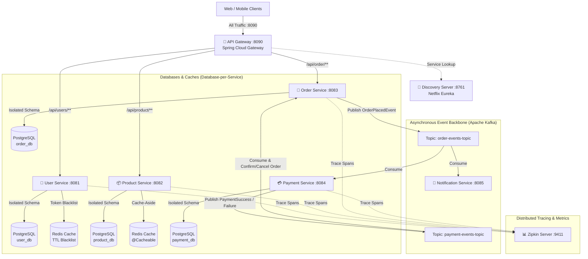

# 🛒 ChaloKharido — Distributed E-Commerce Microservices Platform

[](https://www.oracle.com/java/)
[](https://spring.io/projects/spring-boot)
[](https://spring.io/projects/spring-cloud)
[](https://kafka.apache.org/)
[](https://www.postgresql.org/)
[](https://redis.io/)
[](https://www.docker.com/)
[](https://zipkin.io/)

A complete, production-grade **Event-Driven E-Commerce Microservices Architecture** built using **Java 17**, **Spring Boot 3**, **Spring Cloud**, **Apache Kafka**, **PostgreSQL**, **Redis**, and **Docker**. 

Engineered under the **Database-per-Service pattern**, with an **Event-Driven Choreography Saga** for distributed transactions, **Stateless JWTs with Redis Dynamic-TTL Blacklisting**, **Resilience4j Circuit Breakers**, and **Micrometer & Zipkin Distributed Tracing**.

---

## 🏗️ System Architecture



---

## 📦 Services Directory & Port Mappings

| Service | Port | Tech Stack | Responsibilities |
| :--- | :---: | :--- | :--- |
| **[`api-gateway`](./api-gateway)** | `8090` | Spring Cloud Gateway, JWT | Central reverse proxy, JWT authentication filter, global CORS, downstream identity injection (`X-User-Id`, `X-User-Role`). |
| **[`discover-service`](./discover-service)** | `8761` | Spring Cloud Netflix Eureka | Dynamic service registry, client-side load balancing, instance health heartbeats. |
| **[`user-service`](./user-service)** | `8081` | Spring Boot 3, PostgreSQL, Redis, BCrypt | User registration, authentication, JWT issuing, Redis dynamic-TTL logout blacklist. |
| **[`product-service`](./product-service)** | `8082` | Spring Boot 3, PostgreSQL, Redis Cache | Product catalog, inventory tracking, Redis Cache-Aside (`@Cacheable`) with 10m TTL. |
| **[`order-service`](./order-service)** | `8083` | Spring Boot 3, PostgreSQL, Kafka, OpenFeign | Order placement, OpenFeign inventory lookup, Kafka producer/consumer in Choreography Saga. |
| **[`payment-service`](./payment-service)** | `8084` | Spring Boot 3, PostgreSQL, Kafka | Idempotent payment processing, Kafka event listener, Saga status publisher. |
| **[`notification-service`](./notification-service)** | `8085` | Spring Boot 3, Kafka | Asynchronous notification handler for order confirmation and payment alerts. |

### 🛠️ Infrastructure Services

| Infrastructure Component | Port | Description |
| :--- | :---: | :--- |
| **PostgreSQL 16** | `5432` | Dedicated isolated databases (`user_db`, `product_db`, `order_db`, `payment_db`). |
| **Redis 7** | `6379` | In-memory token blacklist and high-speed cache. |
| **Apache Kafka (KRaft)** | `9092` | Distributed event streaming backbone (no Zookeeper required). |
| **Zipkin** | `9411` | End-to-end distributed latency and request tracing dashboard. |

---

## 🌟 Key Architectural Patterns Implemented

1. **Database-per-Service**: Each microservice manages its own schema (`user_db`, `product_db`, `order_db`, `payment_db`) in PostgreSQL, preventing tight database coupling.
2. **Event-Driven Choreography Saga**: Asynchronous distributed transaction flow without a single point of failure:
   * `Order Service` saves order as `PENDING` $\to$ emits `OrderPlacedEvent` to Kafka.
   * `Payment Service` consumes event $\to$ processes payment idempotently $\to$ emits `PaymentSuccessEvent` or `PaymentFailureEvent`.
   * `Order Service` consumes result $\to$ transitions state to `CONFIRMED` or `CANCELLED`.
   * `Notification Service` dispatches customer alerts in parallel.
3. **Stateless JWT with Dynamic-TTL Redis Blacklist**: Instant logout revocation by blacklisting tokens in Redis with an expiration strictly equal to the remaining token lifetime.
4. **Client-Side Load Balancing & Service Discovery**: Dynamic routing via Netflix Eureka and OpenFeign (`lb://<service-name>`) without hardcoded IPs or ports.
5. **Circuit Breakers & Graceful Fallbacks**: Integrated Resilience4j to prevent cascading failures across inter-service calls.
6. **Distributed Observability**: Every request is tagged with unified `[traceId, spanId]` via Micrometer Tracing and visualized in the Zipkin UI.

---

## 🚀 Quick Start (One Command Launch)

The entire microservices ecosystem and all supporting infrastructure are containerized with Docker Compose.

### Prerequisites
- [Docker Desktop](https://www.docker.com/products/docker-desktop/) (v24+ recommended)
- Java 17 & Maven (for local manual builds)

### 1. Clone the Monorepo
```bash
git clone https://github.com/suzain2024/microservices.git
cd microservices
```

### 2. Build and Launch the Entire Platform
```bash
docker compose up -d --build
```

### 3. Verify Health & Dashboards
* **Eureka Service Registry**: [http://localhost:8761](http://localhost:8761)
* **Zipkin Tracing Dashboard**: [http://localhost:9411](http://localhost:9411)
* **API Gateway**: [http://localhost:8090](http://localhost:8090)

To stop all services:
```bash
docker compose down
```

---

## 📂 Repository Structure

```
microservices/
├── api-gateway/            # Spring Cloud API Gateway (Port 8090)
├── discover-service/       # Eureka Service Registry (Port 8761)
├── user-service/           # User Auth & JWT Profile Service (Port 8081)
├── product-service/        # Product Catalog & Inventory Service (Port 8082)
├── order-service/          # Order Processing & Saga Service (Port 8083)
├── payment-service/        # Payment & Idempotency Service (Port 8084)
├── notification-service/   # Asynchronous Kafka Notification Service (Port 8085)
├── init-scripts/           # PostgreSQL Database Schema Initializers
├── docker-compose.yml      # Multi-container orchestration config
├── build-all.ps1           # Windows PowerShell build automation script
└── README.md               # Master Platform Documentation
```

---

## 👤 Author

* **Suzain Naaz**
* LinkedIn: [@suzain-naaz](https://linkedin.com/in/suzain-naaz-2200b3229)
* GitHub: [@suzain2024](https://github.com/suzain2024)
* LeetCode: [@_suzainnaaz1912_](https://leetcode.com/u/_suzainnaaz1912_/)

---

## 📄 License
This project is licensed under the MIT License.
