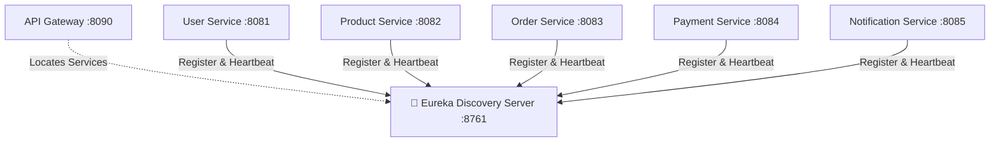

# 🧭 Discovery Service (Netflix Eureka Server) — ChaloKharido

[](https://www.oracle.com/java/)
[](https://spring.io/projects/spring-boot)
[](https://spring.io/projects/spring-cloud)
[](https://cloud.spring.io/spring-cloud-netflix/reference/html/)
[](https://www.docker.com/)

Centralized **Service Registry & Discovery Server** for the **ChaloKharido** e-commerce microservices platform. Built using **Spring Cloud Netflix Eureka Server**, enabling dynamic service registration, client-side load balancing, and zero-hardcoded-IP communication across all distributed services.

---

## 🌟 Key Responsibilities

- **Centralized Service Registry**: Maintains an active catalog of all running microservice instances with hostnames, ports, and health status.
- **Dynamic Discovery**: Allows services like `api-gateway`, `user-service`, `product-service`, and `order-service` to locate each other dynamically using service names (e.g., `lb://user-service`).
- **Heartbeat & Health Checks**: Monitors microservice instances via periodic 30-second heartbeats, automatically evicting dead instances to prevent traffic blackholes.
- **Standalone Registry Mode**: Configured with `register-with-eureka=false` and `fetch-registry=false` so the server acts purely as the registry hub.

---

## 🏗️ Architecture



---

## ⚙️ Configuration

Configured via `application.properties`:

```properties
spring.application.name=discover-service
server.port=8761

# Standalone Registry Server Configuration
eureka.client.register-with-eureka=false
eureka.client.fetch-registry=false
```

---

## 🚀 Running Locally

### Prerequisites
- **JDK 17**
- **Maven** or included Maven Wrapper (`mvnw`)

```bash
# Run with Maven Wrapper
./mvnw clean spring-boot:run
```
*(On Windows: `mvnw.cmd spring-boot:run`)*

### Eureka Dashboard
Once running, open your browser and navigate to:  
👉 **`http://localhost:8761`**  
You will see the Eureka Server dashboard showing all currently connected microservices in real-time.

---

## 🐳 Docker Deployment

```bash
# Build the JAR
./mvnw clean package -DskipTests

# Build Docker Image
docker build -t discover-service:latest .

# Run Container
docker run -d -p 8761:8761 --name discover-service discover-service:latest
```

---

## 👤 Author
* **Suzain Naaz**
* GitHub: [@suzain2024](https://github.com/suzain2024)
