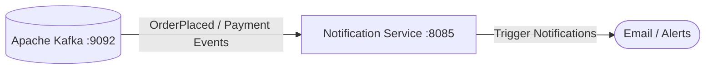

# 🔔 Notification Service — ChaloKharido Microservices Platform

[](https://www.oracle.com/java/)
[](https://spring.io/projects/spring-boot)
[](https://kafka.apache.org/)
[](https://www.docker.com/)

Asynchronous notification consumer service for the **ChaloKharido** e-commerce platform. Built with **Spring Boot 3** and **Apache Kafka** on port `8085`, consuming transactional lifecycle events to trigger email and alert dispatches.

---

## 🌟 Key Features

- **⚡ Asynchronous Event Consumer**: Subscribes to Kafka topics under `notification-group` to process order confirmations and payment alerts without blocking checkout flow.
- **🛡️ Decoupled Reliability**: Ensures customer communications are resilient even during peak traffic spikes.
- **🐳 Containerized**: Dockerized for instant container deployment.

---

## 🏗️ Architecture



---

## ⚙️ Configuration

Configured via `application.properties`:

```properties
spring.application.name=notification-service
server.port=8085

spring.kafka.bootstrap-servers=localhost:9092
spring.kafka.consumer.group-id=notification-group
```

---

## 🚀 Running Locally

```bash
# Run with Maven Wrapper
./mvnw clean spring-boot:run
```
*(On Windows: `mvnw.cmd spring-boot:run`)*

---

## 🐳 Docker Deployment

```bash
# Package JAR
./mvnw clean package -DskipTests

# Build Docker Image
docker build -t notification-service:latest .

# Run Container
docker run -d -p 8085:8085 --name notification-service notification-service:latest
```

---

## 👤 Author
* **Suzain Naaz**
* GitHub: [@suzain2024](https://github.com/suzain2024)
