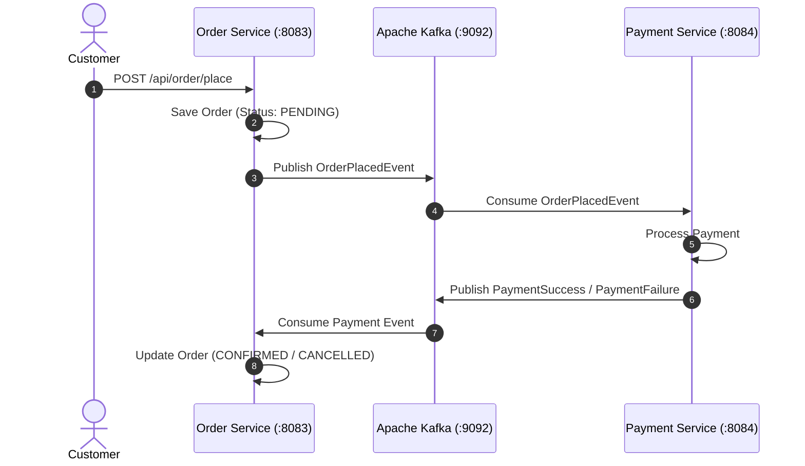

# 🛒 Order Service — ChaloKharido Microservices Platform

[](https://www.oracle.com/java/)
[](https://spring.io/projects/spring-boot)
[](https://www.postgresql.org/)
[](https://kafka.apache.org/)
[](https://cloud.spring.io/spring-cloud-netflix/reference/html/)
[](https://www.docker.com/)

Core order processing and transactional lifecycle microservice for the **ChaloKharido** e-commerce platform. Built with **Spring Boot 3**, **PostgreSQL** (`order_db`), and **Apache Kafka** implementing an **Event-Driven Choreography Saga Pattern** on port `8083`.

---

## 🌟 Key Architectural Features

- **📦 Database-per-Service**: Independent `order_db` schema in PostgreSQL for isolated transactional storage.
- **⚡ Event-Driven Choreography Saga**:
  - Emits `OrderPlacedEvent` asynchronously to Apache Kafka upon order checkout.
  - Consumes `PaymentSuccessEvent` or `PaymentFailureEvent` from `payment-events-topic` to update order state (`CONFIRMED` vs `FAILED/CANCELLED`).
- **🛡️ Distributed Fault Tolerance**: Asynchronous event decoupling ensures orders are captured even during downstream payment latency.
- **🔍 Service Discovery**: Registers dynamically with Eureka Server (`8761`).
- **🐳 Containerized**: Dockerized for seamless container deployment.

---

## 🏗️ Saga Workflow Architecture



---

## ⚙️ Configuration

Configured via `application.properties`:

```properties
spring.application.name=order-service
server.port=8083

spring.datasource.url=jdbc:postgresql://localhost:5432/order_db
spring.datasource.username=postgres
spring.datasource.password=postgres

# Kafka Bootstrap Server
spring.kafka.bootstrap-servers=localhost:9092
spring.kafka.consumer.group-id=order-group

eureka.client.service-url.defaultZone=http://localhost:8761/eureka/
```

---

## 🚀 Running Locally

```bash
# Run with Maven Wrapper
./mvnw clean spring-boot:run
```
*(On Windows: `mvnw.cmd spring-boot:run`)*

---

## 🐳 Docker Deployment

```bash
# Package JAR
./mvnw clean package -DskipTests

# Build Docker Image
docker build -t order-service:latest .

# Run Container
docker run -d -p 8083:8083 --name order-service order-service:latest
```

---

## 👤 Author
* **Suzain Naaz**
* GitHub: [@suzain2024](https://github.com/suzain2024)
