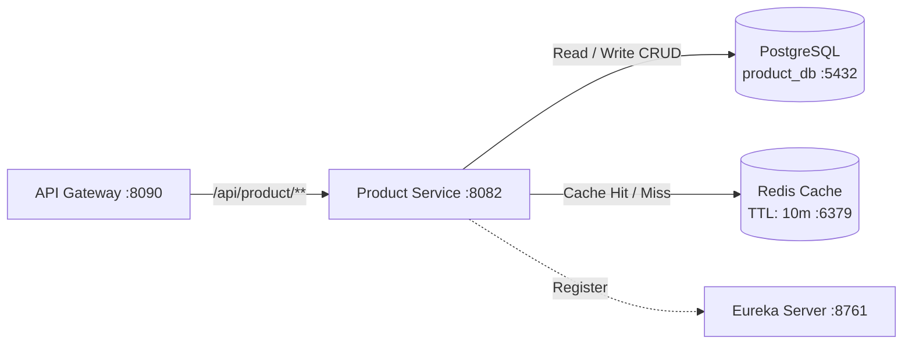

# 📦 Product Service — ChaloKharido Microservices Platform

[](https://www.oracle.com/java/)
[](https://spring.io/projects/spring-boot)
[](https://www.postgresql.org/)
[](https://redis.io/)
[](https://cloud.spring.io/spring-cloud-netflix/reference/html/)
[](https://www.docker.com/)

Product catalog and inventory management microservice for the **ChaloKharido** e-commerce platform. Built with **Spring Boot 3**, **PostgreSQL** (`product_db`), and **Redis Cache-Aside Pattern** on port `8082`.

---

## 🌟 Key Features

- **🛍️ Product Catalog & Stock Management**: Endpoints for creating, updating, listing, and querying product inventory.
- **⚡ Redis Cache-Aside (`@Cacheable`)**: High-throughput read operations cached in Redis with a 10-minute TTL (`600000ms`) to drastically reduce PostgreSQL read load.
- **📦 Database-per-Service**: Independent schema `product_db` ensuring inventory and catalog data are completely decoupled from order and user databases.
- **🔍 Eureka Service Discovery**: Automatically registers with Eureka on port `8761` for client-side discovery and routing via API Gateway.
- **🐳 Containerized**: Dockerized with Alpine JRE for lightweight deployment.

---

## 🏗️ Architecture



---

## ⚙️ Configuration

Configured via `application.properties`:

```properties
spring.application.name=product-service
server.port=8082

spring.datasource.url=jdbc:postgresql://localhost:5432/product_db
spring.datasource.username=postgres
spring.datasource.password=postgres

spring.data.redis.host=localhost
spring.data.redis.port=6379
spring.cache.type=redis
spring.cache.redis.time-to-live=600000

eureka.client.service-url.defaultZone=http://localhost:8761/eureka/
```

---

## 🚀 Running Locally

```bash
# Run with Maven Wrapper
./mvnw clean spring-boot:run
```
*(On Windows: `mvnw.cmd spring-boot:run`)*

---

## 🐳 Docker Deployment

```bash
# Package JAR
./mvnw clean package -DskipTests

# Build Docker Image
docker build -t product-service:latest .

# Run Container
docker run -d -p 8082:8082 --name product-service product-service:latest
```

---

## 👤 Author
* **Suzain Naaz**
* GitHub: [@suzain2024](https://github.com/suzain2024)
